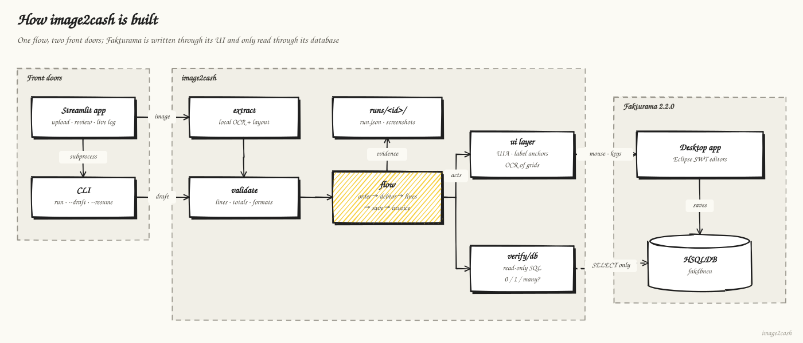
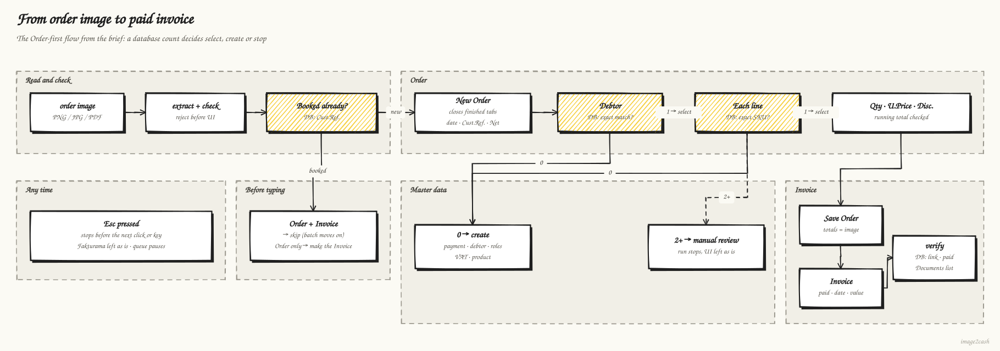
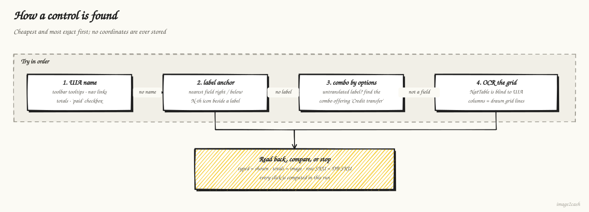

[](https://www.python.org/)
[](https://www.fakturama.info/)
[](https://learn.microsoft.com/windows/win32/winauto/entry-uiauto-win32)
[](https://pywinauto.readthedocs.io/)
[](https://streamlit.io/)
[](https://docs.pydantic.dev/)
[](https://pypi.org/project/indra-ocr/)
[](https://pypdfium2.readthedocs.io/)
[](https://github.com/baztian/jaydebeapi)
[](https://openrouter.ai/)
[](https://docs.astral.sh/uv/)
[](https://docs.pytest.org/)
[](https://docs.astral.sh/ruff/)

# Fakturama Image-to-Cash

This tool turns an order image or PDF into a saved, verified **Order** and a linked
**Invoice** in Fakturama 2.2.0, with the payment status applied. It drives
Fakturama's real GUI with **Microsoft UI Automation** and uses **local OCR**
(Indra) for the image and for Fakturama's custom-drawn grids. Every step is
verified through UI read-back and **read-only** queries on Fakturama's HSQLDB.

> [!IMPORTANT]
> **▶ Watch the demo (76 s): [youtu.be/Sn4Bfru24ZM](https://youtu.be/Sn4Bfru24ZM)**
>
> [](https://youtu.be/Sn4Bfru24ZM)

**Architecture and design rationale (3 pages):** [docs/paper/architecture.pdf](docs/paper/architecture.pdf)
(LaTeX source alongside)

The tool runs from a **Streamlit app**:
1. Upload one or more images or PDFs (each becomes a row in a queue).
2. See what OCR read, with a box drawn around each field.
3. Correct anything that is wrong.
4. Preview what will be created and what will be selected.
5. Press **Book this order**, or **Book all ready** to book the queue one
   order at a time. A batch tries a stopped order once more, then skips it and
   moves on; at the end it lists every skipped order and why.

It runs from a CLI too.

- Design: [`docs/design.md`](docs/design.md) (v1), [`docs/design_v2.md`](docs/design_v2.md) (app, scrolling, USD/pharma data) and [`docs/design_v3.md`](docs/design_v3.md) (speed, queue, PDF, catalogue prices, unseen layouts)
- Review record: [`docs/egm_review.md`](docs/egm_review.md), the Elephant-Goldfish reviews and what the live app revealed
- Diagrams: [`docs/diagrams/`](docs/diagrams), hand-drawn (architecture, flow, control grounding)
- Evidence: [`docs/screenshots/`](docs/screenshots), annotated, one per step

## Diagrams

**Architecture.** The app and the CLI drive the same flow. Fakturama is only written through its UI; its database is only read.



**Order flow.** This is the Order-first flow from the brief. Database counts decide between select, create and manual review.



**Control grounding.** How each control is found, in order of preference. No coordinates are stored.



## Results (live, test workspace, USD)

The samples are a fictional pharmaceutical distributor's orders (US and Canada
customers). They were rendered from the JSON specs in `samples/`. Tax rates:
0 % for prescription items and 6.25 % for over-the-counter supplies.

The runs below were booked in USD as RX-1001 to RX-1003. The workspace now
books in **EUR** (currency locale Germany, `de/DE`: `1.234,57 €`), and the samples were re-rendered in
EUR as `order_RX-2001` to `order_RX-2003`: same customers, products and
amounts, new references, so they don't collide with the USD bookings.

| Image | What it exercises | Outcome |
|---|---|---|
| `order_RX-1001.png`, Boston pharmacy | New debtor; new product; existing payment and VATs; PAID by Credit Card. **Started from the Streamlit app's Proceed button.** | Order PO000006 and Invoice INV000007, paid, verified. One uninterrupted run. |
| `order_RX-1002.png`, Toronto distributor | Canadian postal code; different delivery warehouse; PAID by Bank Transfer | Order PO000007 and Invoice INV000008 ($633.76, paid), in one uninterrupted run of 109 s. |
| `order_RX-1003.png`, Chicago hospital | **8 lines** (the item table scrolls); new VAT 6.25 %; 8 new products; separate delivery address; UNPAID | Order PO000005 and Invoice INV000006 ($2,035.58). This one was built up over several calibration runs (see "found live" below) and finished with `--resume`. |
| `order_WEB-2026-0714-A17.png`, the assessment's own image (EUR) | Reference input | Booked earlier as PO000002 / INV000003 in a workspace that has since been reset. The currency guard stops any order whose currency differs from the workspace's ("order is in EUR, Fakturama books in USD" while it booked in USD). The workspace books in EUR now, so this order passes the guard; it has not been re-run since the switch. |

Run files are stored in `runs/<id>/`:

| File | Contents |
|---|---|
| `run.json` | Every step, the values read back and the DB rows; written after extraction and validation, once driving starts (a rejected source writes none) |
| `run.log` | Timestamped log of every step and every UI action: clicks, typed fields, combo choices, dialogs, saves, grid reads, timeouts |
| `output.log` | Raw console output, for crashes before logging starts; written by the app's runs only, not the CLI |
| `screenshots/` | Annotated screenshots |

The app shows `run.log` live while a run is going, and expanded when a run
fails. It also keeps its own log in `runs/app.log`: extractions, each Proceed
or Resume with its command, and each exit code.

## Setup

**Requirements:** Windows 10/11, Fakturama 2.2.0, Python 3.12, [uv](https://docs.astral.sh/uv/), and Node.js (only to regenerate the diagrams).

> [!WARNING]
> **New PC? Read this first.** The most common first-time failure is Fakturama's
> folders, not the code. Fakturama uses **two** different folders, and the tool
> needs both to belong to a separate **test** setup:
>
> | Folder | What it holds | Who sets it |
> |---|---|---|
> | **Workspace** (Eclipse `-data`) | Fakturama's settings, including where the working directory is | The tool: `%USERPROFILE%\.fakturama2_test`, i.e. `.fakturama2_test` in your Windows user folder (or `FAKTURAMA_WORKSPACE` in `.env`) |
> | **Working directory** | The database and documents | **You**, once, in Fakturama's first-start dialog. Pick a new, empty folder, e.g. `D:\Fakturama_Test_Working` |
>
> Opening Fakturama from the Start menu uses its *default* workspace, which is
> not the test one, so the tool will not see it. Steps for a first run:
>
> 1. **Close every Fakturama window.** An open Fakturama holds the database port
>    (9001), and the tool refuses to start next to it.
> 2. `uv sync`, then `uv run streamlit run app/streamlit_app.py`.
> 3. Pick a sample and press **Book this order**. The app starts Fakturama on the
>    test workspace. On the first start Fakturama asks for a **working directory**.
>    The dialog can open **behind the browser**, so check the taskbar. Choose a new,
>    empty folder (never your real Fakturama data). The run then continues by
>    itself (it waits up to 10 minutes).
>
>    **Expect a pause of up to a minute or two before anything moves.** Fakturama
>    takes about 70 s to start, and loading the OCR models takes a few seconds
>    (or longer if you skipped `uv run image2cash setup`). Nothing is stuck: don't click or press Book again, and keep your
>    hands off the mouse and keyboard once it starts typing.
> 4. If the run stops with *"currency shown by Fakturama … is not recognised"* or
>    *"order is in EUR, Fakturama books in …"*, set **File → Preferences** currency
>    locale to Germany (`de/DE`) as in step 1 below, then book again.
>
> Also needed, because controls are found by their English names and tables are
> read from screenshots:
> - **Fakturama in English.** It follows the Windows display language. On a
>   non-English Windows, add `-nl en` to the start command (a standard Eclipse
>   option; not tested here).
> - **Display scaling at 100 %** (Windows Settings → Display). Other scalings are untested.
>
> If the app says Fakturama *"is not open"*, the message lists which Fakturama
> windows it did find and the exact command to start the test one.

1. Use a **copy** of the Fakturama workspace; runs create real records. To book
   in EUR, set the currency locale to Germany (`de/DE`: `1.234,57 €`) in
   **File → Preferences**. Don't edit the `.prefs` file: Fakturama also keeps the
   setting in its database (`FKT_USERPROPERTY`), and only Preferences updates
   both. Check it by opening a New Order: its Total must show `€`. The run's
   currency guard stops any order in another currency before typing anything.
   Then start Fakturama on that workspace. In PowerShell (replace the first path with
   where *your* `Fakturama.exe` is; `$env:USERPROFILE` fills in your user folder, so
   don't type a user name):
   ```powershell
   & "C:\Program Files\Fakturama2\Fakturama.exe" -data "$env:USERPROFILE\.fakturama2_test"
   ```
   The app's "Fakturama is not open" message prints this command with your real
   paths already filled in.
   In the Streamlit app you can skip this: **Book this order** starts Fakturama on
   the configured workspace if it is closed (about 70 s), then runs the order. It
   refuses to start a second Fakturama while another program holds the database port.
2. Install the dependencies and download the OCR models in one go. `uv run`
   syncs the packages first (like `uv sync`), then `setup` fetches Indra's
   models from Hugging Face once, so the first order isn't slowed down. `uv sync`
   alone cannot do this, because it installs packages but never runs code.
   ```bash
   uv run image2cash setup
   ```
3. Nothing is tied to one PC; the settings are found on each machine
   (`src/image2cash/config.py`), and any of them can be set in `.env`:
   - **Fakturama's folder:** from the running `Fakturama.exe`, else where it
     last ran, else `PATH`, the Windows App Paths registry, or
     `Program Files` / `AppData\Local\Programs`. An unzipped Fakturama that has
     never been seen running needs `FAKTURAMA_HOME` in `.env` once.
   - **Workspace:** `.fakturama2_test` in your user folder, or `FAKTURAMA_WORKSPACE`.
   - **Working directory and database login:** read from that workspace's
     Fakturama preferences (open it in Fakturama once), or `FAKTURAMA_WORKDIR`,
     `HSQL_URL`, `HSQL_USER`, `HSQL_PASSWORD`.
   - **HSQLDB driver:** the `org.hsqldb.hsqldb_*.jar` Fakturama ships, or `HSQL_JAR`.
   - **Which Fakturama is driven.** The test one (window titled
     `Fakturama - <its working directory>`) if it is open. Otherwise the one
     Fakturama that is open, whatever its working directory, so a tester can
     simply open Fakturama as usual and press Book.
   - **Always:** the driven Fakturama must be the program that serves the
     database (port 9001), or every check would read the wrong data. With two
     Fakturamas open and no test one, the run stops and says which are open.
   - **Live data:** if you also keep a live Fakturama, have the test one (or
     none) open when you book; an open live Fakturama alone would be used.

## Run

**The app** (on the PC running Fakturama, at localhost:8501):
```bash
uv run streamlit run app/streamlit_app.py
```
After you press a Book button, don't touch the mouse or keyboard until the page shows the result.

**CLI:** OCR and validate an image or PDF only.
```bash
uv run image2cash extract samples/order_RX-2001.png
```
**AI fallback** for layouts the parser can't read. It sends the image to an
AI model, so it is off unless you ask for it (the toggle in the app, `--ai` on
the CLI). Busy or rate-limited replies get up to 4 attempts (3 retries). Any OpenAI-compatible
chat API works; the default is OpenRouter (`nvidia/nemotron-3.5-super-vl`, a vision model) and needs
a key from openrouter.ai. Copy
`.env.example` to `.env` and put the key in `LLM_API_KEY`:
```bash
cp .env.example .env
```
Another provider or model: change `LLM_BASE_URL` and `LLM_MODEL` in `.env`.
`.env` is git-ignored; a variable set in the shell overrides it.
A local server (Ollama, LM Studio on `http://localhost...`) needs no key and
keeps the image on this machine.
```bash
uv run image2cash extract samples/unseen/hospital_po.png --ai
```
**CLI:** run the full flow.
```bash
uv run image2cash run samples/order_RX-2001.png
```
**CLI:** run a reviewed or edited draft.
```bash
uv run image2cash run --draft runs/<id>/draft.json
```
A run whose reference already has one saved Order and no Invoice continues by
itself: it checks the saved Order against the image, then creates the Invoice.
(`--resume` still works and does the same.)
**CLI:** read-only DB view of the documents for a reference.
```bash
uv run image2cash verify RX-2001
```

**Tests and hooks:** 287 unit tests, plus ruff and hygiene hooks; pytest also runs on push.
```bash
uv run pytest -q
```
```bash
uv run pre-commit install --install-hooks -t pre-commit -t pre-push
```

**Tools:** render the four unseen-layout orders into `samples/unseen/`.
```bash
uv run python tools/make_unseen.py
```
Render a synthetic order from a JSON spec.
```bash
uv run python tools/make_sample.py samples/order_RX-2003.json
```
Regenerate the hand-drawn diagrams:
```bash
cd tools/diagrams && npm install && node make_diagrams.mjs
```

**Exit codes for `image2cash run` (and the app's runs):**

| Code | Meaning |
|---|---|
| 0 | Done and verified |
| 1 | Automation error |
| 2 | Stopped for manual review (the UI is left as it is) |
| 3 | Source rejected; nothing was touched |
| 4 | Another run is in progress (one run at a time, enforced by an OS file lock) |

`image2cash extract` returns 0 for a valid source or 3 for a rejected source;
`image2cash verify` returns 0.

## How it works (short)

1. **Extract.**
   - Indra OCR gives text with boxes. A label-anchored parser maps them to an
     `OrderDraft` and records each field's box (the app draws these).
   - US and Canadian address lines (`Boston, MA 02116`, `Toronto, ON M5J 2S1`)
     and German ones (`10117 Berlin`) are both parsed.
   - Arithmetic checks reject misreads before the UI is touched: line totals,
     net, VAT rounded per rate, and gross.
2. **Ground.**
   - Controls are found by UIA name, or failing that from their label, or by
     the options a combo offers.
   - Fakturama's custom-drawn grids are read by OCR inside the rectangle UIA
     reports. Columns come from the drawn grid lines, named by position.
   - Clicks use cell centres computed in the same run.
3. **Decide.** Whether a debtor, product, VAT or payment method already exists
   is a read-only DB count:
   - 0 → create it;
   - 1 → select it in the Order's selector;
   - 2 or more → manual review.
4. **Verify.**
   - Every typed value is read back.
   - After each line, the running `Total Net` must match.
   - Before saving, the totals must equal the image within the small, documented
     tolerance in `validate.drift`: 1 cent per line + 0.6 cent per unit, because
     catalogue prices are stored as rounded gross. Any difference is recorded as a warning.
   - After each Save, the DB row is checked.
   - At the end: the Invoice is linked to the Order; the paid flag, date, value
     and method are right; the Order is unchanged and still open.

## Fakturama behaviours found live, and how they are handled

| Behaviour | Handling |
|---|---|
| Save throws an NPE when the dynamically added "Delivery address" tab is active (`DocumentEditor.doSave`; the same error appears in the brief's figures) | Select the Invoice-address tab before saving any document |
| The "New product" link throws a ClassCastException (`CallEditor`) after a debtor address was picked in a selector | Use the toolbar's "Create a new product" button |
| Selectors auto-accept as soon as the filter leaves one row | Paste the whole search term at once |
| The Debtor editor loads its Payment list only when it opens | Ensure the payment method *before* opening New Debtor (a documented deviation from brief 2.10) |
| The item table gets its own scrollbar after about 7 rows; the scrollbar buttons ignore UIA Invoke | Maximize the editor area; scroll with the mouse wheel over the grid, and stop if the editor itself moved; the newest line must be the bottom row with `Pos.` = line number |
| Header captions on gray are faint, so OCR reads only some of them | Columns come from drawn grid lines and are named by a majority vote of the captions that were read |
| Segmented date fields | Find each segment by pressing Up and seeing what changed, type the digits, read back |
| Locale differences | Form fields parse in the UI locale; grid cells always take `.`; the VAT percent field takes `.` even where price fields take `,` (typing `6,25` gave 625 %), so it tries `.` then `,` and reads back |
| The e-mail validator rejects `.test` domains | Detected in the DB and reported as a warning (samples use `example.com`) |
| A small (or resized) window puts the Order's fields off-screen, so typing goes nowhere | Maximize Fakturama at the start, and again whenever it was resized or minimized |
| "Save Parts" ignores programmatic unchecking | Click the checkbox glyph and verify; cancel if that fails |

## What is skipped or simplified

- **Unseen layouts need the AI fallback.** The local parser reads one
  document family. The four orders in `samples/unseen/` (a hospital PO, a
  rotated noisy fax, a two-column distributor form, a PDF letter) are all
  rejected offline (exit 3, "label 'CONTACT NAME' not found"), and nothing is
  touched. With `--ai` (or the app toggle) the AI model reads them into the same
  `OrderDraft`; that draft has no field boxes, so the app asks you to check
  every field, and `check_order` plus the DB checks still apply. The fallback
  is unit-tested against a mock API only: no API key was available here.
- **Prices are never typed.** An existing product's catalogue net price must
  match the image to the cent, or the run stops for review. Vendors change
  prices in the product master, not on an order. Because a price matches only
  to the cent, totals may differ by 1 cent per line plus 0.6 cent per unit
  (qty 40 can add 16 cents); any difference is reported as a warning.
- **PDF input uses page 1 only**, rendered at 200 dpi.
- **The queue lives in the browser tab.** Reloading the page loses it. A batch
  tries a "failed" or "manual review" order a second time (from its saved Order
  if it got that far), then skips it; "rejected" is skipped at once. Only "busy"
  pauses it until you press Resume. A skipped order can leave a half-done editor
  open in Fakturama while the next order books.
- **Line-level VAT override** is not automated. An existing product whose VAT
  differs from the image stops for manual review.
- **Order-level discount and shipping** from an image are not mapped. 0 % and
  free shipping are enforced (brief 4.2).
- **Selector dialogs do not scroll.** If a search fills the whole list, the run
  stops for review (`shortcut:` comment in `steps/selector.py`). Exact SKU and
  company searches rarely do.
- **No generic watcher for unexpected dialogs.** The known dialogs are
  handled; anything else times out with a screenshot.
- **Resume only covers "Order saved, Invoice not yet".** An earlier stop needs
  the unsaved Order discarded and a rerun; master data created before the stop
  is reused.
- **Speed:** the 8-line order took 264 s, then about 3 min, then 1 min 50 s
  in a live run of the line-by-line version. That run also showed why line by
  line is fragile: Fakturama rebuilds the item table after every cell edit
  (selection back to line 1, scroll back to the top), and rows differ in
  height. So now all products are added first (each proven by Total Net), the
  table is read once page by page (so long orders work too: about one OCR
  read per 6 lines), and then the Qty column and the Discount column are
  filled, replaying each line's page from the top before its edit. The full-table check before saving stays. Dates are pasted in the
  field's own format and read back; the segment stepping is only a fallback.
  Fixed waits were replaced by polling. Measured on the live app, OCR of
  the item table takes only ~0.2 s; the slow parts were UIA lookups (finding
  the editor folder ~0.4 s, the four totals ~0.75 s), so controls that do not
  move while the Order is open are now cached (totals: 0.75 s -> 0.03 s), and
  screenshots are written in the background. Not yet timed end to end.
- **No cleanup or rollback** of a failed run's records.
- **The app is local only.** It has no authentication and serves one user, so
  don't expose it. The run moves the real mouse, so the desktop must stay
  unlocked and untouched.

## Written question: with 3 more hours

1. **Recovery.** Watch for dialogs between actions. Resume from any step using
   `run.json` and the DB state. Add a `--cleanup` that soft-deletes a run's
   records through the UI.
2. **LLM cross-check.** The vision fallback exists; next, run it on every
   order and diff it field by field against OCR, flagging disagreements.
3. **Batch regression.** Render a few dozen synthetic orders covering ambiguous
   debtors, VAT conflicts and long orders. Run them nightly against a workspace
   restored from a zipped baseline.
4. **Speed.** Reuse a grid read until the header actually moves. Replace fixed
   sleeps with event waits.

## Repository layout

```
app/streamlit_app.py     upload → boxes → review → preview → proceed → live log → result
src/image2cash/
  extract/   ocr.py (Indra + boxes, PDF page 1), layout.py (label-anchored parser, field boxes),
             vision.py (opt-in AI fallback, OpenRouter by default)
  ui/        core.py (locators, editors, screenshots), grid.py (OCR grids), datefield.py
  steps/     order.py, debtor.py, product.py, invoice.py, selector.py, context.py
  verify/    db.py (read-only HSQLDB)
  models.py  validate.py  flow.py (state machine, run lock)  cli.py  config.py
tests/       287 unit tests + recorded OCR fixture
tools/       make_sample.py (order renderer), make_unseen.py (4 unseen layouts), diagrams/ (rough.js)
samples/     pharma orders (JSON spec + PNG), the assessment image, unseen/ (4 layouts + truth)
docs/        design.md, design_v2.md, design_v3.md, egm_review.md, PLAN_v2.md, diagrams/, screenshots/
```

## Tooling used

- **Elephant-Goldfish Model (EGM).** The designs were drafted with full
  context, then reviewed by zero-context "goldfish" subagents: twice for v1 by
  hand, and twice for v2 with the installed plugin's `egm-design` and
  `egm-implementation-readiness` reviewers. Findings and resolutions are in
  `docs/egm_review.md`, `docs/design_v2.md` §6 and `docs/design_v3.md` §6
  (design and zoom-out reviewers on v3).
- **CLAUDE.md in each source folder** records that folder's rules and the
  Fakturama quirks it works around, for the next agent or developer.
- **Ponytail.** A whole-repo audit removed dead helpers and unused options,
  fixed silently dropped address lines and added tests for the rules that
  guard identity, currency and idempotency.
