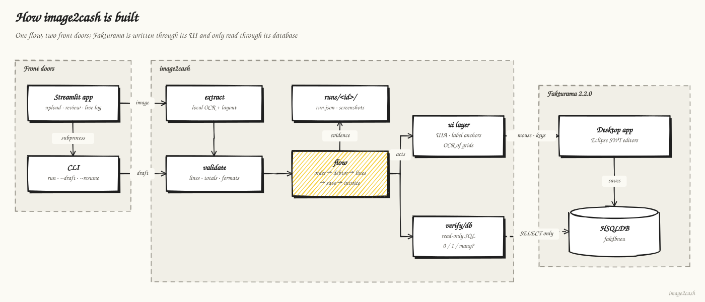
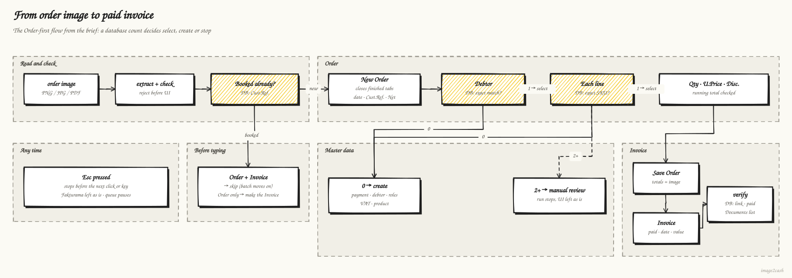
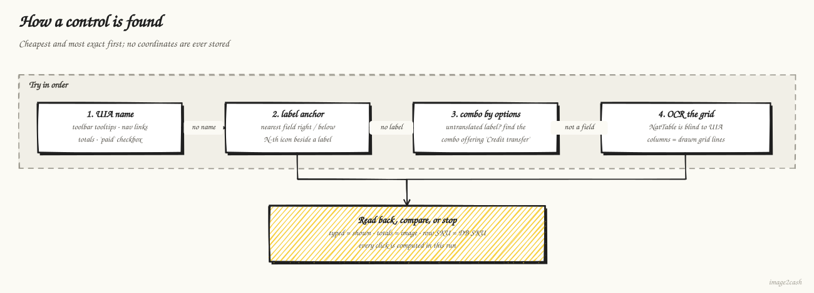
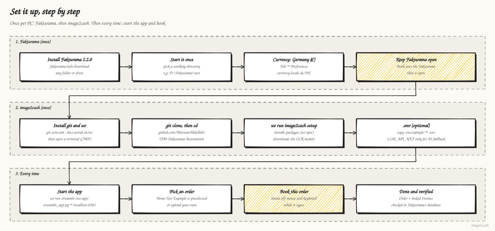

# Diagrams (hand-drawn)

Hand-drawn in the style of [Sketchy](https://github.com/ddkbs/sketchy), generated with rough.js and the embedded Kalam font (SIL OFL, `tools/diagrams/fonts/`). To regenerate:
`cd tools/diagrams && npm install && node make_diagrams.mjs`

## Architecture

The app and the CLI drive the same flow. Fakturama is only written through its UI.
The database is only read, to decide exact matches and to verify what was saved.
Esc stops a run before its next action.

## Business flow

This is the Order-first flow from the brief. A reference that is already booked is
skipped (or, with only its Order saved, finished at the Invoice); database counts
decide between select, create and manual review.

## Control grounding

How each control is found, in order of preference. No coordinates are stored.

## Setup, step by step

What a new user does, once per PC and then every time.

